<p align="center"></p>

<p align="center"><b>Bandas, DOS, PDOS, densidade de carga, defeitos e termodinâmica a partir de cálculos CASTEP</b><br>
Spin up e down · energia de Fermi exatamente a do CASTEP · Origin e VESTA · web, Python e Windows</p>

<p align="center"><a href="https://brunohdmacedo.tech/bruma/">Abrir no navegador</a> · <a href="https://brunohdmacedo.tech/bruma/tutorial.html">Tutorial</a> · <a href="bruma-tutorial.pdf">Tutorial em PDF</a> · <a href="https://github.com/brunohdmacedo/bruma-dft/releases/latest">Baixar para Windows</a> · <a href="#como-citar">Como citar</a> · <a href="docs/MANUAL.md">Manual do autor</a></p>

---

**Bruma** quer dizer névoa: a nuvem eletrônica, isto é, a densidade de carga que o programa mostra. As letras também são as iniciais do autor, **Bru**no **Ma**cedo. A logo representa bandas de valência (ciano) e de condução (violeta) como camadas de névoa, com o nível de Fermi tracejado e um estado de defeito no meio do gap (o ponto âmbar).

> **Manual do autor:** como publicar, manter e atualizar o Bruma e o site (GitHub Pages, citações automáticas, versões, Windows, PyPI, DOI no Zenodo, cluster, LaTeX). Disponível em [docs/MANUAL.md](docs/MANUAL.md) e em PDF ([docs/manual/manual-bruma.pdf](docs/manual/manual-bruma.pdf)).

## Quatro formas de usar

| Forma | Para quem | Como começar |
|---|---|---|
| **Página web** | análise interativa, sem instalar nada | [brunohdmacedo.tech/bruma](https://brunohdmacedo.tech/bruma/): arraste os arquivos |
| **Python, linha de comando** (`bruma.py`) | cluster e scripts, sem interface gráfica | `pip install bruma-dft` e `bruma mgh2_Fe` |
| **Python, com janela** (`bruma_gui.py`) | uso local com cliques (Linux, macOS, Windows) | `pip install "bruma-dft[gui]"` e `bruma-gui` |
| **Programa para Windows** | quem não usa Python | instalador `Bruma-Setup-1.0.0.exe` em [Releases](https://github.com/brunohdmacedo/bruma-dft/releases/latest) |

Todas têm uma parte **Sobre**, com nome, versão, autor, links e como citar. Na linha de comando, use `bruma --sobre`.

### Instalação em Python (cluster ou computador)

```bash
pip install bruma-dft            # só numpy e matplotlib
bruma mgh2_Fe -e Mg,H,Fe         # análise completa em mgh2_Fe_plots/
bruma --sobre                    # autor, links e como citar
```

Também dá para usar sem instalar: copie o `bruma.py` para o cluster e rode `python3 bruma.py mgh2_Fe`.

### Interface gráfica

```bash
pip install "bruma-dft[gui]"     # inclui o Pillow (foto do autor e prévias)
bruma-gui
```

A janela tem três abas:

- **Análise:** pasta, cálculo, etapas e opções, com o registro da execução ao vivo e o botão "Ver comando", que mostra o comando equivalente para o cluster.
- **Resultados:** lista dos arquivos com prévia das figuras; um clique duplo abre o arquivo no programa padrão.
- **Sobre:** autor, foto, redes e citação, com botões de copiar.

No Linux, o Tkinter vem no pacote `python3-tk`.

### Windows (.exe)

O workflow `.github/workflows/windows.yml` compila numa máquina Windows do GitHub:

- `Bruma.exe`: a interface;
- `bruma.exe`: a linha de comando;
- `Bruma-Setup-<versão>.exe`: o instalador, com atalhos no menu Iniciar, atalho na área de trabalho, opção de pôr o `bruma` no PATH e desinstalador.

Para publicar uma versão: `git tag v1.0.0 && git push --tags`. O workflow cria a Release com os três arquivos. Para compilar localmente num Windows, use `packaging\windows\build_windows.bat`.

---

## Sumário

1. [O que é gerado](#o-que-é-gerado)
2. [Arquivos de entrada](#arquivos-de-entrada)
3. [Script Python (cluster)](#script-python-cluster)
4. [Site no navegador](#site-no-navegador)
5. [Abrindo os .dat no Origin](#abrindo-os-dat-no-origin)
6. [Energia de Fermi: o que o código faz e o que não faz](#energia-de-fermi-o-que-o-código-faz-e-o-que-não-faz)
7. [O resumo da análise](#o-resumo-da-análise)
8. [Defeito, distorção e termodinâmica](#defeito-distorção-e-termodinâmica)
9. [Gerar os cálculos de referência](#gerar-os-cálculos-de-referência)
10. [Estrutura 3D e densidade de carga](#estrutura-3d-e-densidade-de-carga)
11. [Comparação entre defeitos](#comparação-entre-defeitos)
12. [Limitações e cuidados](#limitações-e-cuidados)
13. [Problemas comuns](#problemas-comuns)
14. [Créditos e licença](#créditos-e-licença)

---

## O que é gerado

**Bandas.** Você pode ver spin up, spin down, os dois sobrepostos ou lado a lado. Os rótulos dos pontos de alta simetria são detectados automaticamente para redes cúbica, tetragonal, ortorrômbica e hexagonal, e podem ser trocados à mão.

**DOS total e PDOS**, separadas em cinco níveis de detalhe:

| Nível | Exemplo |
|---|---|
| Elemento | Mg, H, Fe |
| Orbital *l* | Fe-s, Fe-p, Fe-d |
| Camada (*n*, *l*) do pseudopotencial | Mg 2p e Mg 3p, Fe 3d e Fe 4s |
| Componente *m* | p<sub>x</sub>, p<sub>y</sub>, p<sub>z</sub>, d<sub>z²</sub>, d<sub>yz</sub>, d<sub>xz</sub>, d<sub>x²−y²</sub>, d<sub>xy</sub> |
| t<sub>2g</sub> e e<sub>g</sub> | t<sub>2g</sub> = d<sub>xy</sub>+d<sub>yz</sub>+d<sub>xz</sub>; e<sub>g</sub> = d<sub>z²</sub>+d<sub>x²−y²</sub> |

Além disso, a PDOS pode ser feita **por átomo**, por exemplo o Fe1 e os H ligados a ele.

**Bandas projetadas (*fat bands*).** O peso de cada orbital aparece sobre cada banda.

**Arquivos `.dat`** prontos para Origin, Excel, gnuplot e xmgrace.

**`resumo.txt`** com E_F, VBM, CBM, gap, N(E_F), polarização de spin, momento magnético, ocupações, centro da banda d, cargas e spins de Mulliken e ligações do dopante.

**`<seed>_up.bands` e `<seed>_down.bands`**: arquivos `.bands` válidos com um spin cada e o E_F original. Eles funcionam no `sumo-bandplot`, por exemplo.

| PDOS por camada | Componentes m do Fe | Bandas projetadas do Fe-d |
|---|---|---|
| 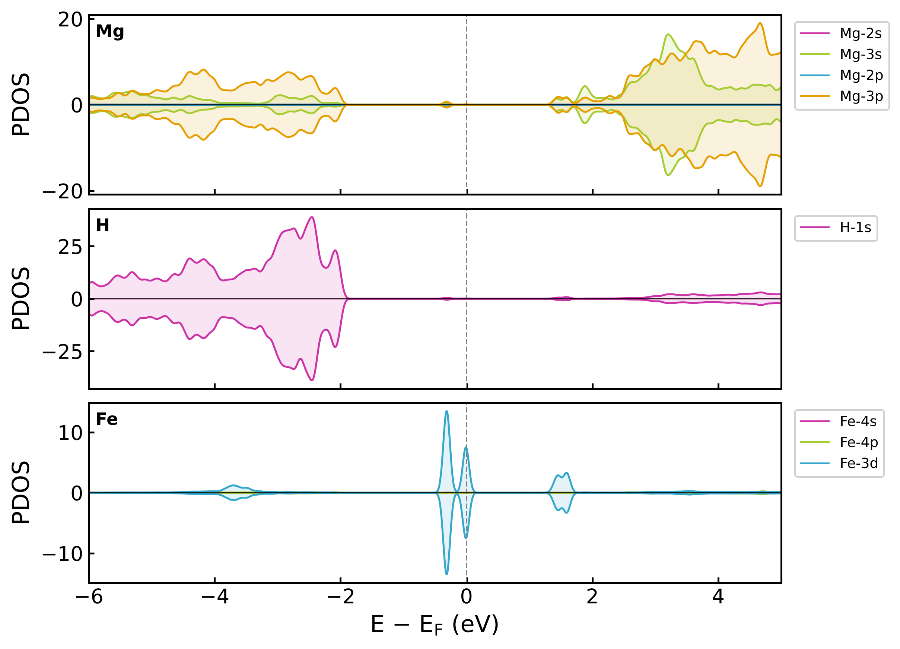 | 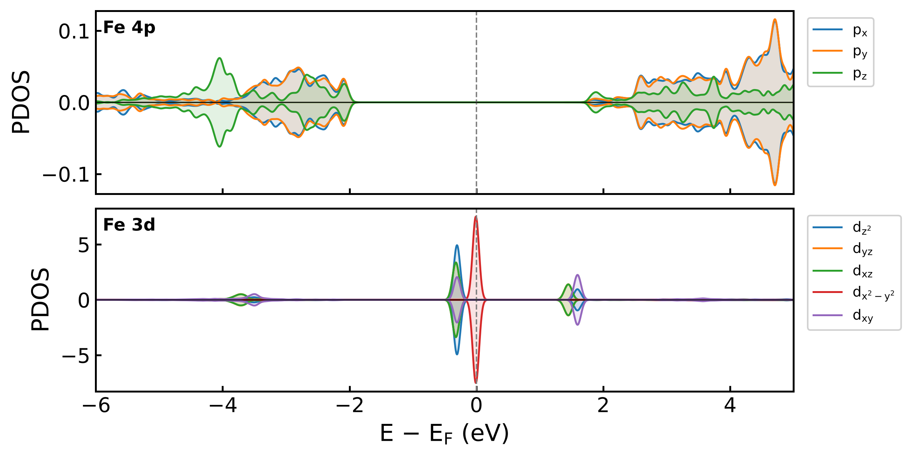 | 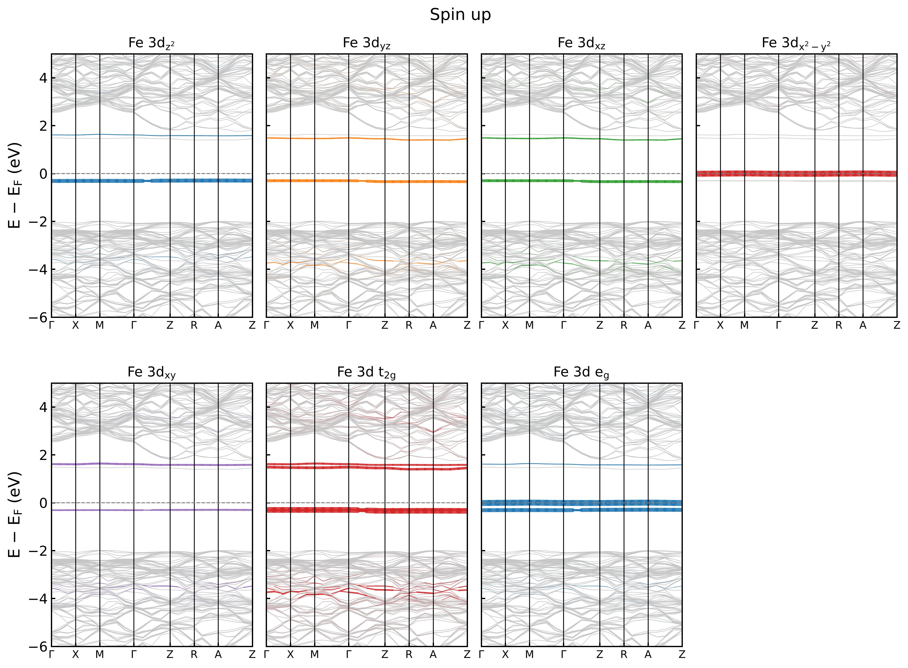 |

---

## Arquivos de entrada

Todos com o mesmo *seedname*, na mesma pasta:

| Arquivo | Obrigatório? | Para quê |
|---|---|---|
| `seed.bands` | **sim** | autovalores, E_F de cada spin, pesos dos k-pontos e célula |
| `seed.pdos_bin` | para PDOS e *fat bands* | peso de cada orbital em cada banda e k-ponto |
| `seed.castep` | recomendado | nomes das camadas (2p, 3d…), ordem dos orbitais m, Mulliken, ligações, spin integrado |
| `seed.cell` | recomendado | ordem das espécies, estrutura do defeito e base para gerar as referências; se faltar, a ordem é lida do `.castep` |
| `seed.den_fmt`, `.cube` ou `CHGCAR` | para a densidade | densidade de carga e de spin (3D, 2D, perfis e exportação para o VESTA) |

**Parâmetros do CASTEP (`.param`)** para gerar tudo isso:

```
TASK                   : SPECTRAL
SPECTRAL_TASK          : BANDSTRUCTURE     ! ou DOS (malha MP densa)
SPIN_POLARIZED         : TRUE
PDOS_CALCULATE_WEIGHTS : TRUE              ! gera o .pdos_bin
POPN_CALCULATE         : TRUE              ! Mulliken e ligações no .castep
```

O caminho de bandas vai no `.cell` (`%BLOCK SPECTRAL_KPOINT_PATH`). Para uma DOS quantitativa, faça um segundo cálculo com `SPECTRAL_TASK : DOS` e uma malha densa (`SPECTRAL_KPOINT_MP_GRID`). Depois indique esse seed com `--dos-seed` (Python) ou em "DOS a partir de" (site).

---

## Script Python (cluster)

### Instalação

```bash
python3 -m pip install --user numpy matplotlib
```

Não precisa de sumo, pymatgen nem castepxbin. Copie `bruma.py` para a pasta do cálculo ou para algum diretório do seu `PATH`.

### Uso

```bash
# 1) O jeito mais simples: detecta o .bands da pasta e pergunta os elementos
python3 bruma.py

# 2) Direto, com os elementos
python3 bruma.py mgh2_Fe -e Mg,H,Fe

# 3) PDOS de átomos específicos e janela de energia menor
python3 bruma.py mgh2_Fe -e Fe,H --sites Fe1,H25,H30 --ymin -4 --ymax 3

# 4) Bandas de um cálculo e DOS de outro (malha densa)
python3 bruma.py mgh2_Fe_bs --dos-seed mgh2_Fe_dos -e Mg,H,Fe

# 5) DOS com spin down negativo nos .dat (gráfico espelhado direto no Origin)
python3 bruma.py mgh2_Fe --down-negative
```

**No SLURM** (`plot.slurm`):

```bash
#!/bin/bash
#SBATCH --job-name=bruma
#SBATCH --ntasks=1
#SBATCH --time=00:30:00
#SBATCH --mem=8G
cd "$SLURM_SUBMIT_DIR"
# module load python    # se o seu cluster exigir
python3 bruma.py mgh2_Fe -e Mg,H,Fe --sites Fe1
```

```bash
sbatch plot.slurm
```

### Opções

| Opção | Padrão | Descrição |
|---|---|---|
| `seed` | detecta | seedname ou arquivo `.bands` |
| `-e, --elements` | todos | elementos da PDOS, ex.: `Mg,H,Fe` |
| `-o, --orbitals` | `s,p,d,f` | orbitais l considerados |
| `--sites` | — | PDOS por átomo, ex.: `Fe1,H25` (número = índice dentro da espécie) |
| `--fermi-ref` | `spin` | `spin`: cada canal com seu E_F; `up`, `down` ou `mean`: E_F comum; `none`: energia absoluta |
| `--ymin`, `--ymax` | `-6`, `5` | janela de energia (eV) |
| `-g, --sigma` | `0.05` | alargamento gaussiano da DOS (eV) |
| `--de` | `0.005` | passo da grade da DOS (eV) |
| `--labels` | auto | rótulos dos pontos k, ex.: `G,X,M,G,Z,R,A,Z` (`G` = Γ) |
| `--dos-seed` | — | seed de um cálculo de DOS separado |
| `--down-negative` | não | spin down com sinal negativo nos `.dat` de DOS |
| `--castep`, `-c/--cell`, `--pdos` | `<seed>.*` | caminhos alternativos dos arquivos |
| `--no-fatbands` | não | não gera bandas projetadas |
| `--fat-scale` | `6` | espessura máxima das *fat bands* (pt) |
| `--no-split` | não | não escreve `_up.bands` e `_down.bands` |
| `--dpi`, `--width`, `--height`, `--fontsize` | `300`, `8`, `6`, `13` | tamanho e qualidade das figuras (polegadas) |
| `--format` | `png` | `png`, `pdf`, `svg`, `eps` |
| `--outdir` | `<seed>_plots` | pasta de saída |

### Arquivos gerados (`<seed>_plots/`)

| Arquivo | Conteúdo |
|---|---|
| `resumo.txt` | toda a análise numérica (veja [abaixo](#o-resumo-da-análise)) |
| `bands_up.dat`, `bands_down.dat` | k (1/Å) + uma coluna por banda (eV) |
| `bands_*_blocos.dat` | o mesmo, uma banda por bloco (gnuplot, xmgrace) |
| `kticks.dat` | posição e rótulo dos pontos de alta simetria |
| `dos.dat` | E, DOS total, por elemento e por orbital l (up e down) |
| `dos_camadas.dat` | por camada: Mg_2s, Mg_3s, Mg_2p, Mg_3p, Fe_3d… |
| `dos_orbitais_m.dat` | por componente m e t2g/eg |
| `dos_sitios.dat` | por átomo (com `--sites`) |
| `fatbands_up.dat`, `fatbands_down.dat` | k, banda, E e peso de cada orbital |
| `<seed>_up.bands`, `<seed>_down.bands` | `.bands` com um spin cada |
| `bands_*.png`, `dos_total.png`, `pdos_*.png`, `bands_dos.png`, `fatbands_*.png` | figuras |

---

## Site no navegador

### Como abrir

- **Online:** [brunohdmacedo.tech/castep](https://brunohdmacedo.tech/bruma/).
- **No seu computador:** dê dois cliques em `index.html`. Ele precisa de internet só para baixar a biblioteca de gráficos (Plotly) e as fontes.
- **No seu próprio site ou no GitHub Pages:** copie o `index.html` para uma pasta do site (ex.: `castep/index.html`). O arquivo é único: não depende de CSS, imagens ou scripts locais.

O visual segue o do [brunohdmacedo.tech](https://brunohdmacedo.tech): tema escuro e claro (botão ☀/☾, o mesmo do portfólio), logo e menu. Em **Aparência → Fundo da figura**, escolha "Branco, para publicação" ou "Cores do tema do site".

**Seus arquivos não saem do computador.** A leitura é feita pelo navegador, sem envio para nenhum servidor.

### Passo a passo

1. Arraste os arquivos (`.bands`, `.pdos_bin`, `.castep`, `.cell`) para a página, ou clique em **Abrir arquivos**. Você pode carregar mais de um cálculo; eles são agrupados pelo seedname.
2. Em **Dados**, escolha o cálculo das bandas e o da DOS, e a referência de energia.
3. Em **Projeção (PDOS)**, escolha o nível (elemento, l, camada, m, t2g/eg ou átomos), os elementos e se quer um painel por elemento.
4. Use as abas **Bandas**, **DOS e PDOS**, **Bandas + DOS**, **Bandas projetadas** e **Análise**.
5. Abaixo do gráfico fica o painel **Editar gráfico: título, legenda e cores**:
   - **Título e eixos:** título da figura (com tamanho e cor), rótulos dos eixos de energia e da DOS, fonte, tamanho do texto, fundo da figura e linhas de grade.
   - **Legenda:** posição (dentro, à direita ou à esquerda; fora; abaixo; sem legenda), tamanho do texto, título da legenda e moldura.
   - **Curvas da figura atual:** para cada curva (bandas up e down, DOS total, cada orbital e a linha de E_F), dá para mudar a cor, o nome na legenda, o traço (contínua, tracejada, pontilhada…), a espessura e se ela aparece.
   - **Direto no gráfico:** clique no nome de uma curva na legenda e digite o novo nome. Um clique simples na legenda esconde ou mostra a curva. As duas mudanças ficam guardadas.
   - As edições valem em todas as abas. Por exemplo, a cor escolhida para "Fe-d" é usada na DOS, em Bandas + DOS e nas bandas projetadas.
   - **Restaurar curvas** desfaz só as edições das curvas. **Restaurar tudo** volta título, legenda e fontes ao padrão.

   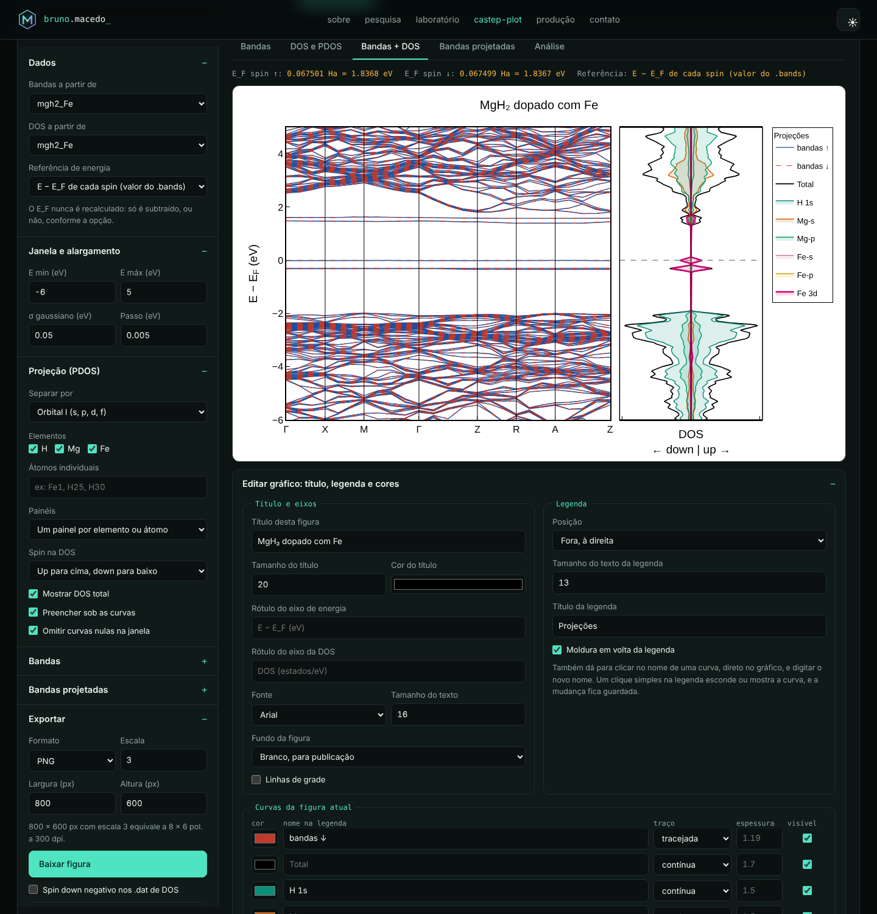

6. Em **Exportar**:
   - **Baixar figura:** PNG, SVG ou JPEG. 800 × 600 px com escala 3 equivale a 8 × 6 polegadas a 300 dpi.
   - **Bandas, DOS e PDOS, pesos das bandas projetadas:** os mesmos `.dat` do Python.
   - **Separar .bands em up e down.**
   - **Resumo da análise (.txt).**

**Para limpar os dados:**
- O botão **Limpar dados**, no topo, remove todos os arquivos carregados e volta à tela inicial. As configurações de janela, aparência e exportação são mantidas.
- O **×** ao lado de cada cálculo remove só aquele seed. É útil quando há vários carregados.

A barra de zoom do gráfico permite aproximar uma região. Com duplo clique, o gráfico volta à janela definida.

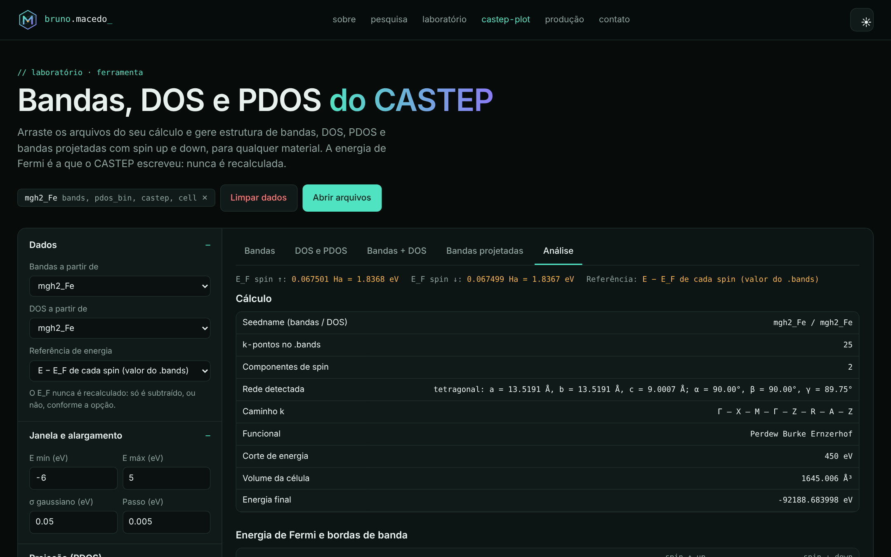

---

## Abrindo os .dat no Origin

Todos os `.dat` têm o mesmo formato:

```
# comentários: E_F do CASTEP, referência, sigma…
E(eV)	TDOS_up	TDOS_down	Fe_d_up	Fe_d_down	…     ← nomes das colunas (TAB)
-6.000000	0.123456	0.123401	0.000012	…        ← dados (TAB)
```

**Importar:** arraste o `.dat` para a janela do Origin ou use *File → Import → Single ASCII*. As linhas com `#` ficam como cabeçalho e a linha de nomes vira o *Long Name* de cada coluna.

Se os nomes não aparecerem, abra *Import Options*. Em *Header Lines*, defina como cabeçalho todas as linhas até a dos nomes e marque a última como *Long Name*. Se o Γ aparecer como símbolo estranho, escolha *UTF-8* em *Character Set*.

**Bandas** (`bands_up.dat`):

1. A coluna 1 (k) é o X. Selecione todas as outras colunas e plote como *Line*.
2. Para as linhas verticais dos pontos de alta simetria, use os valores de `kticks.dat`. Coloque-os em *Axis → Reference Lines*, ou como *Tick Labels* do tipo *Tick-indexed dataset* usando as duas colunas do `kticks.dat`.
3. O zero do eixo de energia já é o E_F do CASTEP (com `--fermi-ref spin`).

**DOS/PDOS** (`dos.dat`):

1. Plote E (coluna 1) contra as colunas desejadas.
2. Para o gráfico espelhado (up para cima, down para baixo), gere com `--down-negative` (Python) ou marque **Spin down negativo nos .dat de DOS** (site).
3. Para preencher a área sob a curva, use *Plot → Basic 2D → Fill Area*.

**Bandas projetadas** (`fatbands_up.dat`):

1. Plote E(eV) contra k(1/A) como *Scatter*.
2. Em *Plot Details → Symbol → Size*, escolha a coluna do orbital (ex.: `Fe_d`) com um fator de escala. Opcionalmente, use a mesma coluna em *Color Map*.

---

## Energia de Fermi: o que o código faz e o que não faz

- **Lê** o E_F de cada spin direto do cabeçalho do `.bands` (`Fermi energies (in atomic units)`).
- **Nunca** recalcula, reajusta ou desloca o E_F com base na DOS, no VBM ou na contagem de elétrons.
- O único efeito da opção `--fermi-ref` (Python) ou de "Referência de energia" (site) é decidir **o que é subtraído do eixo**:

| Opção | Eixo de energia |
|---|---|
| `spin` (padrão) | E − E_F de cada spin. É a escolha certa quando o CASTEP dá dois E_F (spin fixo). |
| `up` / `down` | E − E_F do canal escolhido, igual para os dois spins |
| `mean` | E − média dos dois E_F |
| `none` | energia absoluta em eV; o E_F aparece como linha tracejada no valor original |

O valor original em Ha e em eV aparece no topo do site, no cabeçalho de cada `.dat` e no `resumo.txt`.

---

## O resumo da análise

O `resumo.txt` (Python) e a aba **Análise** (site) trazem:

- **Cálculo:** funcional, corte de energia, volume, energia final, tipo de rede, parâmetros de rede e caminho k.
- **Para cada spin:** E_F (Ha e eV), número de elétrons, VBM − E_F, CBM − E_F, bandas e k-pontos do VBM e do CBM, e gap direto ou indireto.
- **"E_F dentro de banda?":** indica se o E_F corta alguma banda (com tolerância de 5 meV), o que sinaliza um estado metálico ou parcialmente ocupado nesse spin.
- **N(E_F)** e **polarização de spin**, P = (N↑ − N↓)/(N↑ + N↓).
- **Diferença E_F↑ − E_F↓** e **spin integrado** do `.castep` (momento em μB).
- **Ocupação integrada** da PDOS até E_F por elemento e orbital, separada por spin.
- **Centro da banda d**, ocupado e total, relativo a E_F. É útil em catálise e em hidretos dopados.
- **Mulliken:** média por espécie e valores por átomo para dopantes (espécies com até 4 átomos), átomos escolhidos e átomos com |spin| > 0,01.
- **Ligações dos dopantes e átomos escolhidos:** população e comprimento.

**Como o gap é definido:** VBM é o topo da banda N e CBM é o fundo da banda N+1, com N = número de elétrons por spin (ou metade dele, sem polarização). Isso evita que uma banda quase plana no nível de Fermi seja lida como "gap zero".

---

## Defeito, distorção e termodinâmica

Disponível na aba **Defeito e termodinâmica** do site e no Python, que gera `defeito.txt`, `defeito_vizinhos.dat`, `defeito_deslocamentos.dat` e `defeito.png`. Funciona para qualquer defeito pontual: **substitucional, vacância ou intersticial**, em qualquer posição da supercélula.

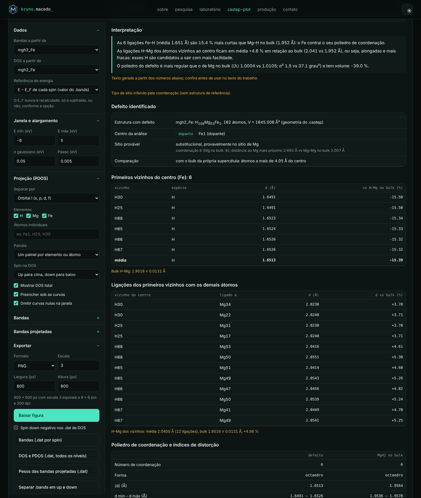

### O que é calculado

| Bloco | Conteúdo |
|---|---|
| Identificação | tipo do defeito, sítio e centro da análise; com referência, lista todos os defeitos encontrados |
| Primeiros vizinhos | cada ligação X–viz. (ex.: Fe–H), sua distância na estrutura pura e a variação contra o bulk (ex.: Mg–H) |
| Ligações dos vizinhos | as ligações dos primeiros vizinhos com os outros átomos (ex.: **H–Mg** dos H ligados ao Fe), contra a referência e o bulk |
| Poliedro | número de coordenação, ⟨d⟩, índice de distorção de Baur D, coordenação efetiva ECoN, volume, elongação quadrática ⟨λ⟩, variância angular σ², ângulos; para o defeito, o mesmo sítio na referência e um poliedro do hospedeiro no bulk |
| Segunda camada | os 12 átomos seguintes, com distância |
| Campo de deslocamentos (com referência) | \|Δr\| de cada átomo contra a distância ao defeito, média por faixa de 1 Å, componente radial (contração ou expansão), raio a partir do qual a perturbação some, variação de a, b, c e do volume da célula |
| Termodinâmica | energia de formação do defeito, entalpia de formação do hidreto por H₂, efeito do defeito (ΔΔH), temperatura de dessorção, energia de remoção de H, capacidade gravimétrica |
| Verificações | força máxima residual, funcional e corte iguais entre os cálculos, energia corrigida ou não para base finita |
| Interpretação | frases automáticas a partir dos números, para conferir e adaptar no texto |

### Arquivos

- **Estrutura com o defeito:** o `.castep` (usa a última geometria) ou o `.cell`. Se só houver estrutura, sem `.bands`, o site abre direto nesta aba e o Python faz só esta análise.
- **Estrutura pura (opcional, recomendada):** a mesma supercélula sem o defeito. Com ela, os átomos são casados um a um (por posição, com condições periódicas). Isso identifica o tipo de defeito sozinho e dá os deslocamentos reais.
- **Sem a referência,** a comparação é feita com o "bulk" da própria supercélula, isto é, com os átomos longe do defeito. O tipo de sítio de um dopante é então inferido pela coordenação e pela distância ao cátion mais próximo.
- **Vacâncias e intersticiais de espécies do próprio hospedeiro** (H, Mg) precisam da referência ou do centro informado à mão: um rótulo como `H25`, ou coordenadas fracionárias como `0.5 0.5 0.25`.

### Termodinâmica: fórmulas

Com $E$ as energias totais e $\mu_i$ as energias por átomo das referências elementares, todas calculadas com o mesmo funcional, corte e pseudopotenciais:

- **Energia de formação do defeito:** $E_f = E_\text{defeito} - E_\text{pura} - \sum_i n_i\,\mu_i$, com $n_i > 0$ para átomos adicionados. Ex.: Fe no lugar de Mg dá $n_\text{Fe} = +1$ e $n_\text{Mg} = -1$.
- **Entalpia de formação do hidreto por mol de H₂:** $\Delta H_f = \dfrac{E - \sum_i N_i\,\mu_i}{N_\text{H}/2}$, com $\mu_\text{H} = \tfrac12 E(\text{H}_2)$. O resultado é convertido para kJ/mol H₂.
- **Efeito do defeito:** $\Delta\Delta H = \Delta H_\text{defeito} - \Delta H_\text{pura}$. Valor positivo significa que o defeito desestabiliza o hidreto, o que facilita liberar H₂.
- **Temperatura de dessorção (van ’t Hoff a 1 bar):** $T_d = \Delta H / \Delta S$, com ΔS = 130,7 J/(mol·K), a entropia padrão do H₂ gasoso. O valor de ΔS pode ser alterado.
- **Energia de remoção de H** (com a estrutura de "H a menos"): $E_\text{rem} = E(\text{sem } n\,\text{H}) + n\,\mu_\text{H} - E_\text{defeito}$, dada por H removido.

Para obter os $\mu_i$, faça um cálculo de cada referência elementar com os mesmos parâmetros: Mg hcp, Fe bcc (com spin) e uma molécula de H₂ numa caixa. Carregue os `.castep` no site: cada um com uma só espécie é reconhecido e a energia por átomo entra sozinha. No Python, use `--mu "Mg=@mg_bulk,Fe=@fe_bcc,H=@h2"`, ou digite os valores, como em `--mu "Mg=-975.3,Fe=-855.6,H=-15.85"`.

### Uso no Python

```bash
# só o defeito, sem referência (compara com o bulk da própria supercélula)
python3 bruma.py mgh2_Fe

# com a estrutura pura, potenciais químicos e a estrutura com um H a menos
python3 bruma.py mgh2_Fe --ref mgh2_puro --mu "Mg=@mg_bulk,Fe=@fe_bcc,H=@h2" --h-less mgh2_Fe_semH

# vacância de H: o centro é encontrado comparando com a referência
python3 bruma.py mgh2_vacH --ref mgh2_puro
```

| Opção | Padrão | Descrição |
|---|---|---|
| `--ref` | — | seed da estrutura pura |
| `--center` | auto | centro: rótulo (`Fe1`) ou `"x y z"` fracionário |
| `--shell-factor` | `1.25` | 1ª camada = d<sub>mín</sub> × fator |
| `--rcut` | auto | raio fixo da 1ª camada (Å) |
| `--rfar` | auto | distância mínima ao defeito para contar como bulk (Å) |
| `--mu` | — | potenciais químicos (eV/átomo) ou `@seed` |
| `--energy` | `auto` | `auto` (estimativa a 0 K nos metais, Final energy nos demais), `final`, `corrected`, `zeroK` ou `free` |
| `--dS` | `130.7` | ΔS de dessorção (J/mol·K) |
| `--h-less` | — | seed com H a menos, para a energia de remoção |
| `--no-defect` | não | pula esta análise |

### Cuidados

- **Energias de 0 K:** são energias eletrônicas, sem energia de ponto zero nem termos vibracionais. A ZPE do H₂ e do hidreto costuma mudar ΔH em alguns kJ/mol. Os valores de $T_d$ são estimativas para comparar tendências.
- **Consistência entre cálculos:** compare apenas cálculos com o mesmo funcional, corte, pseudopotenciais, malha k equivalente e, se usar, o mesmo U de Hubbard. O código avisa quando o funcional ou o corte diferem.
- **Supercélula:** se a perturbação não decair dentro dela, a energia de formação ainda tem interação entre imagens do defeito. Nesse caso use uma supercélula maior.
- **Índices ⟨λ⟩ e σ²:** valem para octaedros e tetraedros (Robinson, Gibbs & Ribbe, *Science* **172**, 567, 1971). O índice D segue Baur (*Acta Cryst. B* **30**, 1195, 1974).

---

## Gerar os cálculos de referência

A termodinâmica precisa de outros cálculos: a estrutura pura e as referências elementares. Eles podem ser gerados direto do `.cell` do defeito:

- **No site:** aba **Defeito e termodinâmica → Gerar os cálculos de referência a partir deste .cell → Baixar (.zip)**.
- **No Python:** `python3 bruma.py mgh2_Fe --gerar-referencias`.

| Cálculo | O que é | Para quê |
|---|---|---|
| `<seed>_puro` | a mesma supercélula, com o dopante trocado pelo hospedeiro (ex.: Fe1 → Mg) ou sem o intersticial | referência pura (`--ref`) |
| `<seed>_semH_perto` | sem o H ligado ao dopante cujas ligações H–metal são mais longas | energia de remoção de H perto do defeito (`--h-less`) |
| `<seed>_semH_longe` | sem o H mais distante do defeito | mesma energia longe do defeito, para comparar |
| `Mg_hcp`, `Fe_bcc`, `H_H2`… | referência elementar de cada espécie: hcp, bcc, fcc, diamante, molécula numa caixa | μ de cada elemento |

Cada pasta traz `.cell` e `.param` com estas configurações:

- **Do seu cálculo:** funcional, corte, spin, tolerância eletrônica, ocupação fixa, as mesmas strings de pseudopotencial (`SPECIES_POT`), massas e, se houver, o bloco `HUBBARD_U`.
- **Malha k:** as supercélulas usam exatamente a mesma malha do defeito. As referências elementares usam a mesma densidade de pontos (n<sub>i</sub>·d<sub>i</sub> constante).
- **Metais:** saem com `METALS_METHOD : dm` e alargamento de 0,1 eV. Fe, Co e Ni partem ferromagnéticos (`SPIN=` nos átomos).
- **Moléculas:** H₂ e outras ficam numa caixa de 12 Å, só no ponto Γ, com a célula fixa.
- **Todos:** `TASK : GeometryOptimization`, `WRITE_FORMATTED_DENSITY : true` e `POPN_CALCULATE : true`.

Junto vêm um `LEIAME.txt` com o comando de análise pronto e um `rodar_todas.sh`. Depois de rodar, carregue tudo no site (os μ são reconhecidos sozinhos) ou use o comando do `LEIAME.txt`.

**Confira antes de rodar:**

- **Estruturas elementares:** usam parâmetros de rede experimentais e serão relaxadas. Para elementos fora da tabela, o arquivo é um átomo isolado, com um aviso, e precisa ser trocado pela fase sólida estável.
- **Tipo de relaxação:** relaxe todas as supercélulas do mesmo jeito que o defeito, com célula variável ou fixa.

---

## Estrutura 3D e densidade de carga

Aba **Estrutura 3D e densidade** do site. Com `--density` (ou se o `<seed>.den_fmt` existir na pasta), o Python também gera o corte 2D, o perfil e o arquivo `.xsf`.

**Arquivo de densidade:** o CASTEP grava o `<seed>.den_fmt` quando o `.param` tem `WRITE_FORMATTED_DENSITY : true`. Também são aceitos `.cube` (por exemplo, do `c2x`) e `CHGCAR`, inclusive o gerado pelo `den2vasp`.

O `CHGCAR` do `den2vasp` está no formato VASP 4 e não tem a linha dos elementos. Nesse caso, escolha em **Estrutura** o `.cell` com os mesmos átomos na mesma ordem. Os elementos vêm do `.cell`, mas as posições e a célula continuam as do próprio `CHGCAR`, que são as da densidade.

**Grandezas disponíveis:**

- **ρ:** densidade de carga total.
- Com polarização de spin:
  - **ρ↑ e ρ↓:** densidade de cada spin;
  - **ρ↑ − ρ↓:** densidade de spin;
  - **|ρ↑ − ρ↓|:** magnetização;
  - **ζ = (ρ↑ − ρ↓)/ρ:** polarização local, de −1 a 1.
- **Δρ = ρ(A) − ρ(B) − ρ(C):** densidade de diferença, por exemplo ρ(MgH₂:Fe) − ρ(MgH₂ sem Fe) − ρ(Fe isolado na mesma célula). Mostra onde os elétrons se acumulam (vermelho) ou saem (azul) ao formar as ligações. As três densidades precisam da mesma célula e da mesma grade, ou seja, do mesmo corte.

**Cargas e momentos por átomo:**

- **Partição de Voronoi** da densidade da grade (comum ou radical) para o defeito, os seus primeiros vizinhos e a média de cada espécie.
- **Colunas:** elétrons, Z de valência do pseudopotencial (lido do `.castep`), carga líquida = Z − elétrons, momento magnético (μB) e volume.
- **Esfera de raio R** em volta do defeito: elétrons e momento.
- **No Python:** `--voronoi plain|radical|off` gera o `cargas_voronoi.txt`.

É uma estimativa, boa para comparar defeitos com a mesma partição. O padrão é o Voronoi comum, porque o radical, com raios covalentes, subestima ânions grandes como o H⁻. Para valores quantitativos, use o programa `bader` com o `CHGCAR` exportado.

**Vistas:**

| Vista | Conteúdo |
|---|---|
| 3D | átomos com cores CPK, ligações, célula e isosuperfície com isovalor e opacidade ajustáveis; para spin e Δρ, superfícies positiva (amarela) e negativa (azul). O defeito e os seus vizinhos aparecem destacados. |
| Corte 2D | plano por três átomos (padrão: o dopante e dois vizinhos) ou plano cristalográfico (h k l) por um átomo ou fração; escala logarítmica ou linear, contornos e átomos a menos de 0,6 Å do plano. |
| Perfil | densidade ao longo da linha entre dois átomos (padrão: o dopante e o vizinho mais próximo). O mínimo ao longo da ligação aproxima o ponto crítico de ligação e indica a força da ligação. |

**Exportações:**

- **`CHGCAR` para o VESTA** (botão *Exportar CHGCAR para o VESTA*; no Python, `--chgcar`). Faz o mesmo que o `den2vasp`, com algumas melhorias:

| | `den2vasp` | Bruma |
|---|---|---|
| Formato | VASP 4: só o número total de átomos | **VASP 5: linha com os elementos e o número de cada um**, e o VESTA mostra Mg, H e Fe com as cores certas |
| Posições | 6 casas decimais | precisão completa do `.cell` |
| Grandeza | só ρ | ρ, **densidade de spin** ou **Δρ**; opcionalmente o spin como 2º bloco |
| Valores | ρ·V (convenção do VASP) | ρ·V, igual: integra o mesmo número de elétrons |
| Entrada | `.castep` + `.den_fmt` | `.den_fmt`, `.cube` ou `CHGCAR`, com `.cell`/`.castep` |

  No VESTA, use *File → Open* no arquivo `…_CHGCAR.vasp` e ajuste o nível em *Properties → Isosurfaces*. O VESTA divide os valores pelo volume da célula; confira na janela a unidade usada pela sua versão.

- **Corte 2D e perfil** em `.dat` (x, y, valor; distância, valor), prontos para o Origin.
- **`.xsf`** para o VESTA ou o XCrySDen.
- **PNG** pela câmera de cada gráfico.

### Contribuição do defeito: Δρ = ρ(defeito) − ρ(puro)

Em **Grandeza**, escolha *contribuição do defeito: Δρ*. Em *Subtrair ρ(B)*, escolha a densidade do material puro; ela é escolhida sozinha se o nome contiver "puro".

**Grades diferentes:** a densidade subtraída é reamostrada na grade do defeito por interpolação trilinear. Para resultados limpos, use grades idênticas.

**Três formas, da mais simples à mais limpa:**

| Diferença | Mostra | Cálculos necessários |
|---|---|---|
| ρ(defeito) − ρ(puro relaxado) | efeito eletrônico mais a relaxação (dipolos nos átomos que se moveram) | `seed_puro` |
| ρ(defeito) − ρ(puro na geometria do defeito) | só a troca do hospedeiro pelo dopante, com grade e posições idênticas | `seed_dif_puro_fixo` (single point) |
| ρ(defeito) − ρ(sem o dopante) − ρ(só o dopante) | **densidade de ligação** do dopante | `seed_dif_sem_X` e `seed_dif_so_X` (single point) |

Os três cálculos *single point* são gerados pelo gerador de referências, na aba Defeito e termodinâmica.

**O que é mostrado:**

- elétrons ganhos e perdidos, e o saldo, que é a diferença de elétrons de valência (ex.: Fe com Z = 8 no lugar de Mg com Z = 10 dá −2);
- ∫Δρ em esferas de 0,6 a 2 Å em volta do dopante;
- **transferência de carga por átomo**, ∫Δρ na célula de Voronoi de cada átomo, para o dopante, os vizinhos e por espécie;
- Δ(ρ↑ − ρ↓) para o efeito no spin;
- na aba **Comparação**, Δρ de cada cálculo contra a referência pura no mesmo plano;
- *Limite da escala de cor ±* para realçar a redistribuição fraca nos vizinhos.

**No Python:** `--field diff --subtract mgh2_Fe_dif_puro_fixo.den_fmt` gera o corte, a galeria e o `transferencia_carga_voronoi.txt`.

**Todas as componentes e os dois sentidos:**

- **Componentes:** Δρ total, Δρ↑, Δρ↓ e Δ(ρ↑ − ρ↓), cada uma subtraída componente a componente.
- **Sentido:** *ρ(defeito) − ρ(puro)* (positivo = o defeito tem mais elétrons) ou *ρ(puro) − ρ(defeito)* (positivo = o puro tem mais elétrons).
- **Vistas:** valem para a isosuperfície 3D (± em vermelho e azul), os cortes (h k l), a galeria, os perfis e a transferência de carga por átomo.
- **Região 3D:** célula inteira ou caixa de ±3, ±4 ou ±6 Å em volta do defeito.

**Na aba Comparação:**

- a diferença de cada defeito contra a referência pura **em 3D**, lado a lado, com isovalor comum e caixa em volta do defeito, e em 2D no mesmo plano;
- **Exportar para o VESTA: todos os cálculos (.zip):** uma pasta por cálculo com os CHGCARs (VASP 5, com elementos) de ρ, ρ↑, ρ↓, ρ↑ − ρ↓ e das quatro diferenças contra a referência, opcionalmente também em `.xsf`;
- um `LEIAME_VESTA.txt` com a faixa de valores de cada arquivo e o passo a passo no VESTA (isosuperfícies ± e cortes (110) e (1̄10) com *2D Data Display*).

**No Python:** `--vesta --subtract mgh2_puro.den_fmt --diff-sign puro-defeito` gera os mesmos 8 CHGCARs e o LEIAME.

**Opções no Python:**

| Opção | Descrição |
|---|---|
| `--density` | arquivo `.den_fmt`, `.cube` ou `CHGCAR` (padrão: `<seed>.den_fmt`) |
| `--field` | `rho`, `up`, `down`, `spin`, `absm`, `zeta` ou `diff` |
| `--voronoi` | `plain` (padrão), `radical` ou `off`: cargas e momentos por átomo |
| `--subtract` | para `diff`: arquivos a subtrair, `"a.den_fmt,b.den_fmt"` |
| `--plane` | `"Fe1,H30,H68"` ou `"hkl:0 0 1@Fe1"` |
| `--plane-size` | lado do corte em Å (padrão 8) |
| `--line` | `"Fe1,H30"` |
| `--chgcar` | exporta CHGCAR (VASP 5, com elementos) para o VESTA, como o `den2vasp` |
| `--chgcar-spin` | com `--chgcar`: inclui a densidade de spin como 2º bloco |
| `--vesta` | exporta ρ, ρ↑, ρ↓, spin e, com `--subtract`, as diferenças de cada um, em CHGCAR |
| `--diff-sign` | `defeito-puro` (padrão) ou `puro-defeito` |
| `--xsf` | exporta .xsf (VESTA/XCrySDen) |

| Isosuperfície 3D | Corte 2D |
|---|---|
| 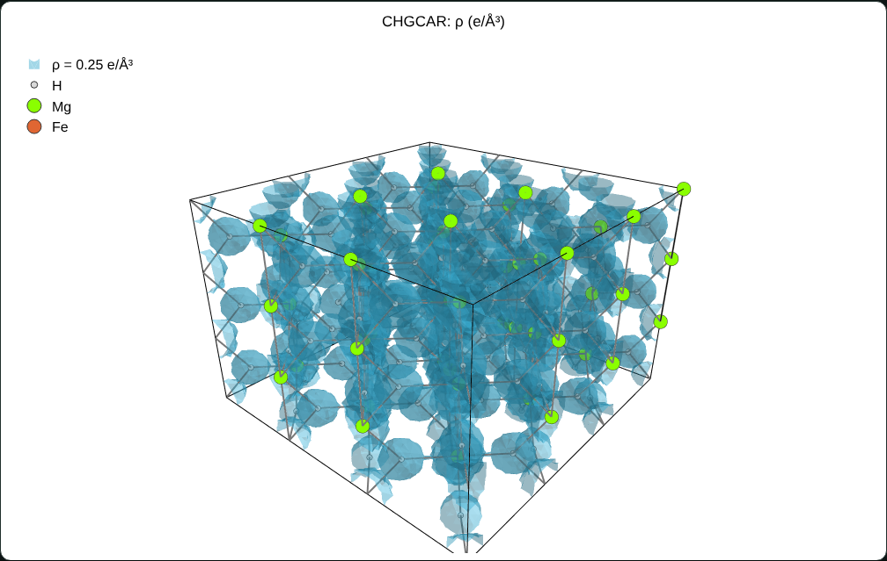 | 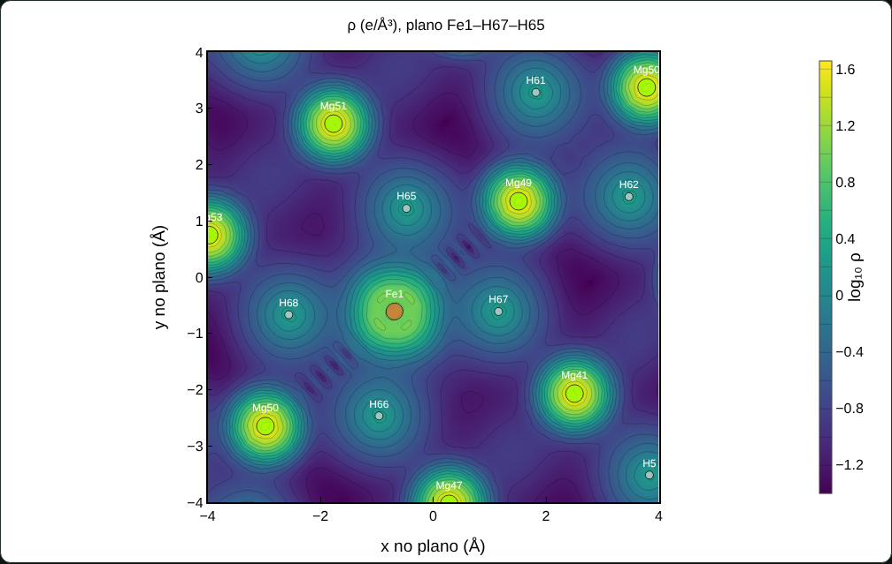 |

*Densidade de um `CHGCAR` real gerado pelo `den2vasp` (90×90×60 pontos, 651 elétrons). Os elementos foram atribuídos pela ordem dos átomos do `mgh2_Fe.cell`.*

**Equivalente ao `./den2vasp seed` no cluster:** `python3 bruma.py seed --chgcar` gera o `seed_plots/seed_CHGCAR.vasp`.

### Planos cristalográficos, galeria e célula

Na mesma aba, o corte 2D pode ser feito por qualquer plano (h k l). Há atalhos para (110), (1̄10), (001), (100), (010), (101), (011), (111), (1̄11) e (210), e o campo "outro" aceita qualquer plano (ex.: `1 1 2`, `-2 1 0`, `(1-10)`).

- **Índices de Miller:** valem na **célula base detectada**. O código encontra a multiplicidade da supercélula (para o seu MgH₂: **3×3×3** do rutilo, a = 4,548 Å e c = 3,017 Å), então (110) é o (110) usual do material. Também dá para usar os índices da supercélula inteira.
- **Eixos do corte:** seguem direções da rede contidas no plano. No (110), horizontal [1̄10] e vertical [001]; no (1̄10), [110] e [001]. O eixo horizontal é a direção mais longa da seção.
- **Seção completa:** o corte cobre a seção inteira da supercélula, com o contorno da célula pontilhado, ou um quadrado de lado escolhido.
- **Deslocamento ao longo da normal:** um controle desliza o plano, em Å e em múltiplos de d<sub>hkl</sub>, para percorrer a família de planos.
- **Átomos do corte:** aparecem os átomos a menos de ±0,6 Å do plano (ajustável), com rótulos.
- **Galeria:** mostra os planos principais lado a lado pela mesma posição (padrão: o defeito), com escala de cor comum. A lista de planos é editável e todos os cortes podem ser baixados em `.dat` (zip).
- **Sem densidade:** o corte e a galeria funcionam só com o `.cell`, mostrando os átomos de cada plano.

| (110) do MgH₂:Fe com a densidade real do CHGCAR | Galeria de planos pelo dopante |
|---|---|
| 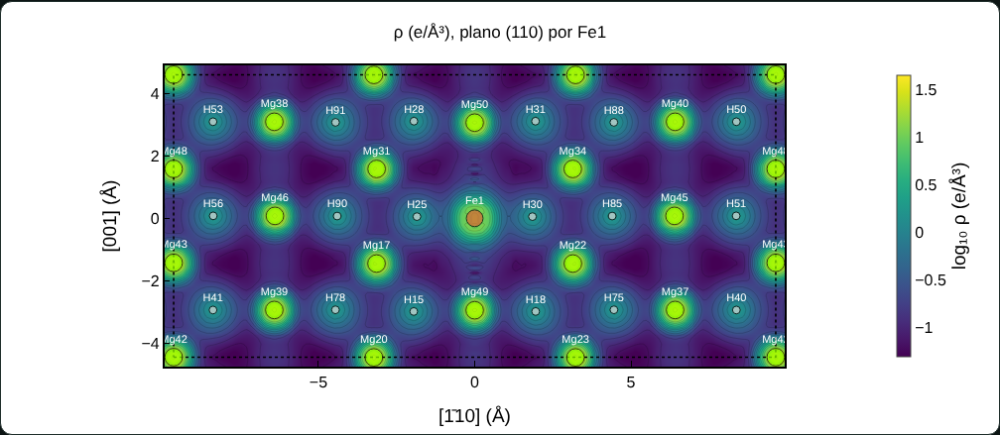 | 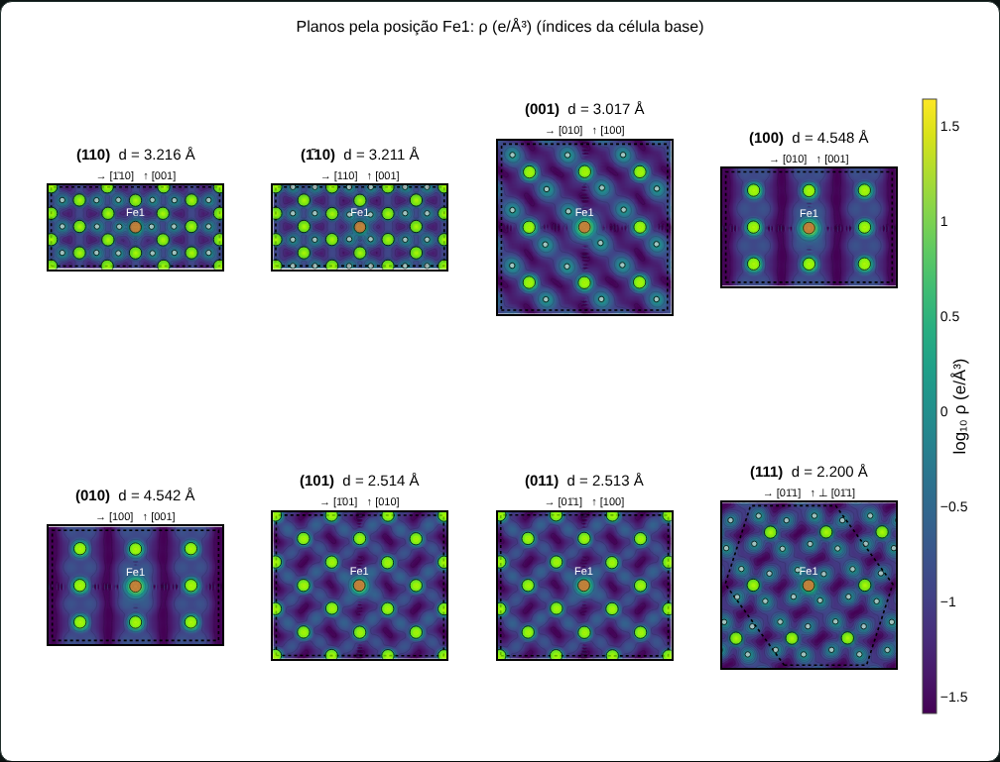 |

No rutilo, (110) e (1̄10) são equivalentes por simetria no material puro, mas pelo sítio do dopante cortam arranjos diferentes de H. A ligação apical do octaedro MgH₆ (ou FeH₆) fica num deles e as equatoriais no outro. A galeria permite comparar os dois diretamente.

**Painel "Célula e supercélula"** (no Python: `<seed>_estrutura.txt`):

- composição e parâmetros da supercélula;
- multiplicidade detectada e parâmetros da célula base (c/a, volume, átomos por célula base);
- densidade (g/cm³), % em massa de H e densidade volumétrica de H (kg H/m³);
- coordenação média de cada espécie e composição dos vizinhos (ex.: H com 2,94 Mg + 0,06 Fe);
- menor distância entre átomos da mesma espécie;
- distâncias de 1ª camada por par (mín/média/máx);
- espaçamentos interplanares d<sub>hkl</sub> dos planos principais, na célula base e com índices da supercélula.

**No Python:**

```bash
# galeria com os 8 planos principais pelo defeito + estrutura.txt
python3 bruma.py mgh2_Fe --planes todos
# galeria escolhida, com a densidade, e corte principal (110) pelo Fe1
python3 bruma.py mgh2_Fe --density CHGCAR --planes "1 1 0; -1 1 0; 0 0 1" --plane "hkl:1 1 0@Fe1"
```

| Opção | Descrição |
|---|---|
| `--planes` | lista de planos separados por `;`, ou `todos` |
| `--hkl-base` | `base` (padrão: célula base detectada) ou `super` (índices da supercélula) |
| `--plane "hkl:h k l@átomo"` | corte principal por um plano cristalográfico, com os mesmos eixos alinhados |

Saídas: `planos_rho.png` (galeria), um `plano_<hkl>_rho.dat` por plano (ex.: `plano_m110_rho.dat` para (1̄10)) e `estrutura.txt`.

**Observação técnica:** a isosuperfície do site é reamostrada numa grade cartesiana de até ~110 pontos por eixo, para caber no navegador. O corte e o perfil usam a grade original com interpolação trilinear periódica. Para figuras 3D finais, o `.xsf` no VESTA tem mais resolução.

---

## Diferença de densidade (puro × defeito)

Aba **Diferença de densidade**: um relatório dedicado à redistribuição de carga causada pelo defeito.

**Escolhas:**
- a densidade com defeito e a de referência (o puro, que é escolhido sozinho);
- opcionalmente um terceiro termo, para a densidade de ligação com `dif_sem_X` e `dif_so_X`;
- a componente: total, ↑, ↓ ou magnetização;
- o sentido: puro − defeito ou defeito − puro.

| Bloco | Conteúdo |
|---|---|
| Indicadores | elétrons nas duas densidades e ΔN; acúmulo e depleção (∫Δ > 0 e < 0); carga redistribuída ½∫\|Δ\|; raios de 50% e 90% da redistribuição; máximo acúmulo e máxima depleção com o átomo mais próximo; momento de dipolo da redistribuição (e·Å e Debye); variação do momento magnético |
| Ligações | ρ mínimo (≈ ponto crítico) de cada ligação dopante–vizinho contra a mesma ligação do hospedeiro no puro, com a variação em % |
| Carga por átomo | elétrons de Voronoi de cada átomo no defeito e no mesmo sítio do puro (casados pelo mapeamento), Δ, ∫Δρ na célula, momentos e somas por espécie |
| 2D | tríptico ρ(puro) \| ρ(defeito) \| Δρ no plano (110), (1̄10), (001)…, com escala de ρ comum e escala de Δ saturada no percentil 95 |
| 3D | tríptico de isosuperfícies numa caixa de ±3 a ±6 Å em volta do dopante, com as ligações |
| Perfis | média esférica ⟨Δ⟩(r) e carga acumulada ΔQ(r) (blindagem), com as distâncias da 1ª camada; médias planares ao longo de a, b e c; ρ(puro), ρ(defeito) e Δ ao longo da ligação dopante–vizinho |

**Exportação:**
- relatório `.txt`;
- `.zip` com os perfis radial e planares, a carga por átomo e os três cortes em `.dat` para o Origin, mais os CHGCARs do defeito, da referência na grade do defeito e da diferença, para o VESTA.

---

## Comparação entre defeitos

Aba **Comparação** do site. Basta carregar os arquivos de vários cálculos, cada seedname sendo um cálculo (por exemplo `mgh2_Fe`, `mgh2_Ni`, `mgh2_Co`, `mgh2_puro`, `Mg_hcp`, `Fe_bcc`, `H_H2`), e marcar quais entram na comparação.

**Tabela comparativa**, uma coluna por cálculo, exportável em `.dat` (TAB, para o Origin) e `.txt`:

| Bloco | Grandezas |
|---|---|
| Identificação | composição, nº de átomos, supercélula detectada, centro e tipo de sítio, funcional e corte |
| Energia e termodinâmica | energia total e por átomo, E<sub>f</sub> do defeito, ΔH<sub>f</sub> do hidreto, ΔΔH contra a estrutura pura, temperatura de dessorção |
| Estrutura eletrônica | E<sub>F</sub> por spin (valor do CASTEP), gap ↑, ↓ e total (banda N → N+1), tipo e k-pontos do gap, E<sub>F</sub> dentro de banda, N(E<sub>F</sub>), polarização em E<sub>F</sub>, ocupação e momento d do dopante (PDOS), centro da banda d |
| Magnetismo e cargas | spin integrado do `.castep`, carga e spin de Mulliken do dopante, elétrons e momento de Voronoi do dopante, ρ no mínimo da ligação dopante–vizinho |
| Estrutura e distorção | NC, ⟨d⟩ dopante–vizinhos e Δ contra o hospedeiro no bulk, ligações dos vizinhos (ex.: H–Mg) e Δ, volume do poliedro, ⟨λ⟩, σ², índice de Baur, deslocamento máximo, raio de perturbação, ΔV/V |
| Célula | a, b, c, γ, V, densidade, % em massa de H, H volumétrico, força máxima residual |

**Gráficos de comparação:**

- barras de qualquer grandeza da tabela;
- DOS total sobreposta (spin ↑ para cima, ↓ para baixo);
- PDOS do dopante (d, p, s ou total), do H ou do hospedeiro;
- bandas lado a lado na mesma janela, com o gap no título;
- comprimentos de ligação em torno do dopante contra o bulk;
- deslocamentos contra a estrutura pura;
- densidade (ρ, ρ↑, ρ↓, spin ou ζ) no mesmo plano (110), (1̄10), (001)… pelo dopante de cada cálculo, com escala de cor comum;
- perfis de densidade do dopante ao vizinho mais próximo.

Os μ, o tipo de energia e o ΔS vêm da aba **Defeito e termodinâmica**. A janela de energia, σ, fonte e cores vêm da barra lateral e do editor de gráfico.

**Cada cálculo continua referido ao seu próprio E<sub>F</sub>,** exatamente como o CASTEP escreveu.

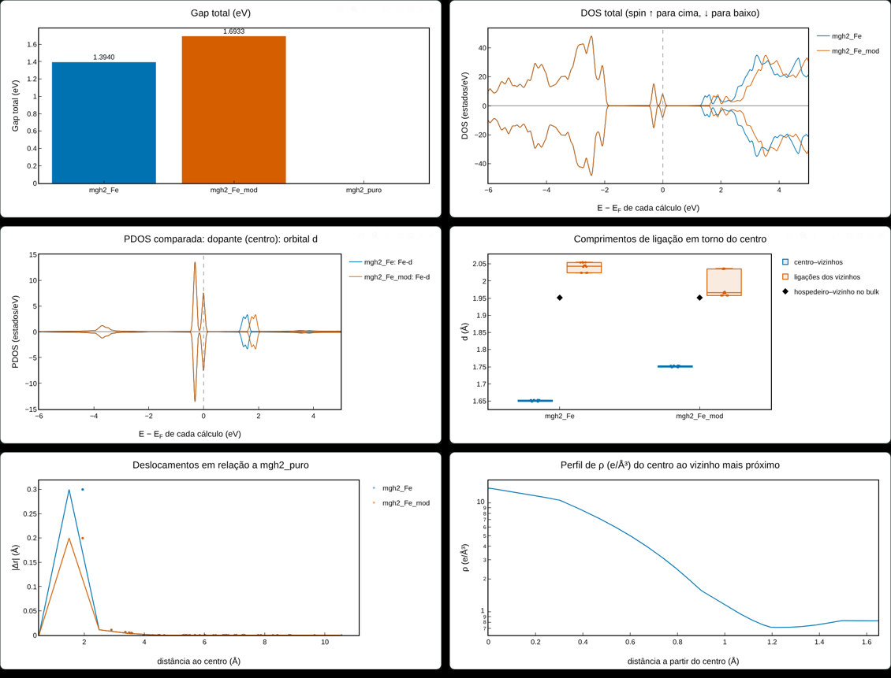

*Exemplo com o `mgh2_Fe` e uma cópia modificada (autovalores acima de E<sub>F</sub> +0,3 eV e H vizinhos afastados 0,1 Å), só para ilustrar.*

---

## Tutorial e como citar

- **Tutorial completo:** `tutorial.html` (online em [brunohdmacedo.tech/bruma/tutorial.html](https://brunohdmacedo.tech/bruma/tutorial.html)). Explica cada aba, as fórmulas, as boas práticas e como citar.
- **Tutorial em LaTeX:** `bruma-tutorial.tex`, compilado em `bruma-tutorial.pdf`. Compile com XeLaTeX + BibTeX; no Overleaf, escolha o compilador XeLaTeX.
- **Referências:** `bruma.bib` traz o software, o TCC, a dissertação, o trabalho do 2º Encontro de Física Aplicada na Tríplice Fronteira e as referências dos métodos (CASTEP, PBE, Monkhorst–Pack, Mulliken, Baur, Robinson, Hoppe, Voronoi, Bader, VESTA etc.).
- **`CITATION.cff`:** faz o GitHub mostrar o botão *Cite this repository*.

Os títulos do TCC e da dissertação foram tirados do portfólio e estão marcados com `CONFIRA` nos comentários do `.bib`.

## Limitações e cuidados

- **DOS a partir do caminho de bandas.** Com `SPECTRAL_TASK : BANDSTRUCTURE`, a DOS sai só dos k-pontos do caminho. Isso serve para ilustração, mas não é quantitativo. Use um cálculo de DOS com malha densa (`--dos-seed`). O código avisa quando há menos de 100 k-pontos.
- **Gap e bordas** vêm dos k-pontos do caminho. O extremo real pode estar fora dele.
- **Componentes m e t2g/eg** usam os eixos x, y, z da célula. A divisão t2g/eg só tem sentido de campo cristalino se o octaedro estiver alinhado a esses eixos; no rutilo, por exemplo, ele fica girado 45° no plano xy.
- **A PDOS do CASTEP** é uma projeção na base atômica (LCAO). A soma dos pesos é 1 menos o *charge spilling* (mostrado no `.castep`).
- **No site, arquivos grandes:** o `.pdos_bin` é carregado inteiro na memória do navegador. Acima de ~1 GB, prefira o script Python.
- **Os rótulos dos pontos k** cobrem redes cúbica simples, tetragonal, ortorrômbica e hexagonal. Para outras redes (FCC, BCC, monoclínica…), use `--labels` ou o campo de rótulos no site.

**Atenção para quem usou versões anteriores (antes de 11/2026).** O `.pdos_bin` grava, para k-pontos repetidos no caminho (Γ no meio, por exemplo), o índice do primeiro k-ponto idêntico. A versão antiga ordenava por esse índice e trocava a ordem de alguns k-pontos. A versão atual usa a ordem do arquivo e confere pelas coordenadas. Refaça PDOS e *fat bands* antigas.

---

## Problemas comuns

| Mensagem ou sintoma | Causa e solução |
|---|---|
| `nenhum .bands na pasta atual` | Rode na pasta do cálculo ou informe o seed: `python3 bruma.py meu_seed`. |
| `os k-pontos do .pdos_bin não batem` | O `.pdos_bin` é de outro cálculo. Use o par `.bands` + `.pdos_bin` gerado pela mesma execução. |
| Camadas aparecem como `s(1)`, `s(2)` | Falta o `.castep`. Coloque-o na pasta ou use `--castep`. |
| Rótulos k entre parênteses, ex.: `(0.333,0.5,0)` | Ponto fora da tabela da rede. Use `--labels G,X,M,…`. |
| Site sem gráfico | Sem internet para baixar o Plotly. Conecte-se, ou baixe o `plotly.min.js` e troque o `src` no `index.html`. |
| `ModuleNotFoundError: matplotlib` | `python3 -m pip install --user numpy matplotlib` |

---

## Como citar

> MACEDO, B. H. D. **Bruma**: análise de estrutura de bandas, DOS, PDOS, densidade de carga, defeitos e termodinâmica a partir de cálculos CASTEP. Versão 1.0.0. Foz do Iguaçu, 2026. Software. Disponível em: https://brunohdmacedo.tech/bruma/.

```bibtex
@misc{macedo2026bruma,
  author       = {Macedo, Bruno Henrique Dourado},
  title        = {Bruma: análise de estrutura de bandas, {DOS}, {PDOS}, densidade de carga, defeitos e termodinâmica a partir de cálculos {CASTEP}},
  year         = {2026},
  version      = {1.0.0},
  howpublished = {\url{https://brunohdmacedo.tech/bruma/}},
  note         = {Código-fonte: \url{https://github.com/brunohdmacedo/bruma-dft}}
}
```

Cite também o CASTEP: S. J. Clark *et al.*, *Z. Kristallogr.* **220**, 567 (2005).

- **Mais referências:** o `bruma.bib` traz também o TCC, o artigo, a base de dados e as referências dos métodos.
- **GitHub:** o `CITATION.cff` faz o GitHub mostrar o botão *Cite this repository*.

## Autor

**Bruno Henrique Dourado Macedo**: Engenheiro Físico (UNILA) e mestrando em Física Aplicada (PPGFISA/UNILA), bolsista CNPq. Tem 4 anos de iniciação científica em Ciência de Dados e Machine Learning e 3 anos em Ciência dos Materiais com Deep Learning e DFT, com foco em sustentabilidade e novos materiais.

[Site](https://brunohdmacedo.tech/) · [Lattes](http://lattes.cnpq.br/7842985016416991) · [ORCID](https://orcid.org/0000-0002-8152-0950) · [Google Acadêmico](https://scholar.google.com/citations?user=zl-LdTMAAAAJ&hl=pt-BR) · [LinkedIn](https://bit.ly/3VlPBAE) · [GitHub](https://bit.ly/47dlUt0) · [YouTube](https://bit.ly/3HGUTDW) · [Instagram](https://bit.ly/465SETR) · [E-mail](mailto:brunohdmacedo@gmail.com)

## Créditos e licença

Baseado nos scripts `plot_all_dos_bands.sh` (Bruno H. D. Macedo) e `separar_up_down.py` (Luiz Cláudio), de 07/2025.

Escolha uma licença antes de publicar. A MIT é uma opção comum para ferramentas científicas: no GitHub, use *Add file → Create new file → LICENSE → Choose a license template*.

**Estrutura do repositório**

```
bruma-dft/
├── bruma.py                  # linha de comando (cluster): python3 bruma.py <seed>
├── bruma_gui.py              # interface gráfica (Tkinter): python3 bruma_gui.py
├── index.html                # Bruma na web (GitHub Pages)
├── tutorial.html             # tutorial completo
├── bruma-tutorial.tex / .pdf # tutorial em LaTeX e PDF
├── bruma.bib · CITATION.cff  # citações
├── pyproject.toml            # pip install bruma-dft (comandos bruma e bruma-gui)
├── assets/                   # logo (SVG, PNG 16–1024 px, .ico)
├── packaging/windows/        # instalador (Inno Setup) e build_windows.bat
├── .github/workflows/        # windows.yml: compila os .exe e o instalador
├── img/ · docs/img/          # figuras do tutorial e do manual
├── docs/MANUAL.md            # manual do autor (GitHub); docs/manual/: LaTeX e PDF
├── tools/                    # versao.py (troca a versão) e copiar_para_site.sh
├── examples/                 # jobs SLURM e PBS
└── README.md                 # este manual
```
